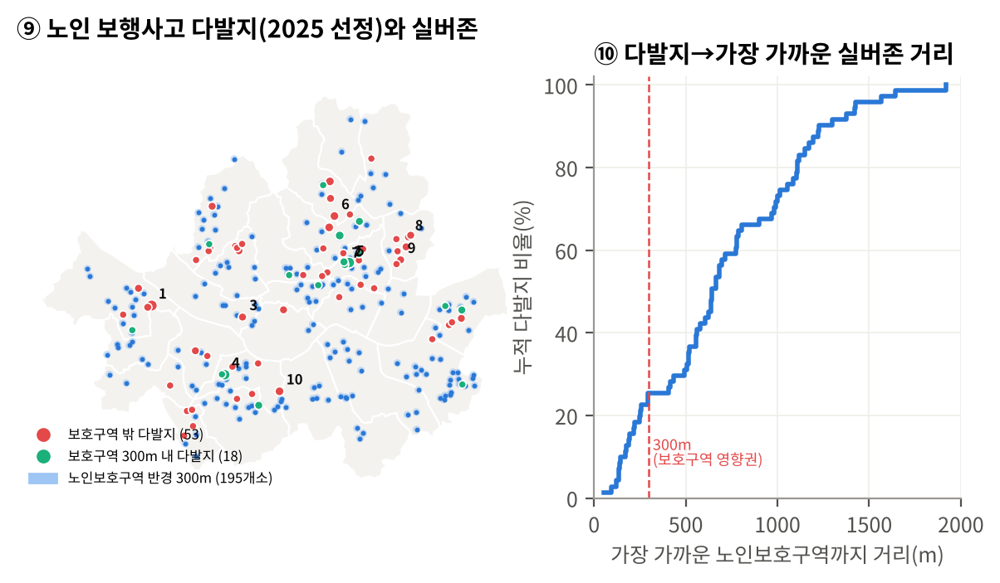

# 실버존은 사고 나는 곳에 있는가?
### 서울 노인 보행사고 다발지 × 노인보호구역(실버존) 공간 불일치 분석

「AI와 함께하는 교통문제 해결을 위한 데이터 분석 공모전」((재)숲과나눔 풀씨행동연구소·한겨레) 출품작의 분석 코드입니다.



## 제출 문서
- [분석보고서 (PDF)](docs/rkun_분석보고서.pdf)
- [참가신청서 (PDF)](docs/rkun_참가신청서.pdf)

## 핵심 결과
| 지표 | 값 |
|---|---|
| 서울 노인 보행사고 (2021→2025) | 1,722건 → 2,060건 (+19.6%) |
| 5년간 보행 사망자 | 노인 338명 / 어린이 6명 |
| 보행사고 100건당 보호구역 | 어린이 88.4곳 / 노인 2.0곳 (44배) |
| 보행노인 다발지 71곳 중 실버존 300m 밖 | 53곳 (74.6%) |
| 다발지 71곳(서울 면적 0.37%)에 몰린 노인 보행 사망·중상 | 12.4% |

## 실행 방법
```bash
pip install -r requirements.txt
# 1) TAAS 원자료 6개를 data/raw/ 에 준비 (아래 '데이터' 참고)
python src/analysis.py      # outputs/figures, outputs/tables, outputs/summary.json 생성
```
그림의 한글 글꼴은 Noto Sans CJK입니다. Windows에서는 `src/analysis.py`의 `font.family`를 `Malgun Gothic`으로 바꾸면 됩니다.

## 데이터
| 파일 | 내용 | 출처 | 저장소 포함 |
|---|---|---|---|
| taas_seoul_elderly_ped_accidents_2021_2025.csv | 서울 노인 보행자 사고 9,564건 | 한국도로교통공단 TAAS GIS | ✕ (tools/taas_collect.js로 수집) |
| taas_seoul_child_ped_accidents_2021_2025.csv | 서울 보행 어린이 사고 1,846건 | TAAS GIS | ✕ |
| taas_seoul_ped_hotspot_zones.csv / _accidents.csv | 보행노인·보행어린이 사고다발지역과 소속 사고 | TAAS GIS 다발지분석 | ✕ |
| taas_seoul_protection_zones_points.csv / _polygons.csv | 서울 어린이·노인 보호구역 1,827곳 | TAAS GIS 보호구역사고조회 | ✕ |
| mois_pop_seoul_202609.csv | 서울 행정동별 1세 단위 주민등록인구(2026.9.30) | 행정안전부, [공공데이터포털](https://www.data.go.kr/data/15097972/fileData.do) | ○ |
| data/ext/seoul_municipalities_geo_simple.json | 서울 자치구 경계 | [southkorea/seoul-maps](https://github.com/southkorea/seoul-maps) | ○ |

- TAAS 자료는 [TAAS 이용약관](https://taas.koroad.or.kr/web/shp/adi/initUseStplat.do?menuId=WEB_KMP_IID_UST) 제14조(정보의 배포 제한)를 지키기 위해 저장소에 넣지 않았습니다. [TAAS GIS](https://taas.koroad.or.kr/gis/mcm/mcl/initMap.do?menuId=GIS_GMP_STS_RSN) 화면에서 `tools/taas_collect.js`를 실행하면 같은 파일을 받을 수 있습니다.
- 출처: 한국도로교통공단 교통사고분석시스템(TAAS), https://taas.koroad.or.kr (수집일 2026-10-27)
- 좌표계: EPSG:5179(UTM-K)

## 분석 단계
1. **전처리**: 사상자·사망중상(KSI) 계산, 시간·유형 변수화, 연령별 인구 합산
2. **추이·치사율**: 노인 vs 어린이 (그림 1)
3. **보호구역 공급**: 인구·사고 대비 보호구역 수 (그림 2)
4. **자치구 보호 공백 지수** = z(노인 1만 명당 KSI) − z(노인 1만 명당 실버존) (그림 3)
5. **사고 특성**: 요일×시간대, 사고유형별 중상 이상 비율 (그림 4)
6. **공간분석**: 다발지–실버존 최근접 거리, 300m 커버리지, 연도별 반복 선정 (그림 5)
7. **K-평균 군집**: 다발지별 사고 구성 5개 변수, k=2~6 실루엣 비교 → k=4 (그림 6)
8. **우선순위 점수**: 사상자 40·사망 20·반복 20·실버존 거리 20 → Top 10 (`outputs/tables/t4_priority_top10.csv`)

## AI 활용
Claude(Anthropic)를 데이터 수집 보조, 분석 코드·시각화 작성, 보고서 초안 작성에 활용했습니다. 모든 수치는 이 스크립트로 원자료에서 다시 계산해 확인했습니다.
